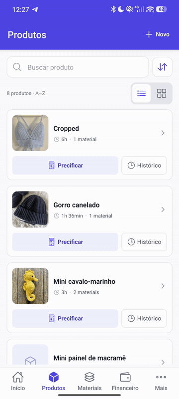

# Precifica Arte

Aplicativo mobile de precificação voltado para artesãos e pequenos empreendedores.

`React Native` · `Expo` · `TypeScript` · `SQLite` · `Firebase`

## Instalação rápida (Android)

O aplicativo compilado para Android é distribuído pela seção [Releases do GitHub](https://github.com/llaneiro/precificacao-artesanato/releases).

1. Acesse a release e baixe o arquivo APK.
2. Abra o arquivo no dispositivo Android e autorize a instalação dessa fonte, caso solicitado.
3. Instale o aplicativo e crie sua conta ou entre com uma conta existente.

A versão compilada não exige Expo Go, Node.js ou configuração manual do Firebase. Para iOS ou execução a partir do código-fonte, consulte a seção [Como executar localmente](#como-executar-localmente).

## Sobre o projeto

O Precifica Arte surgiu da necessidade de facilitar a definição de preços de produtos artesanais, considerando não apenas os materiais utilizados, mas também o tempo de produção, as despesas do negócio e a remuneração do artesão.

O objetivo é simplificar esse processo por meio de uma ferramenta intuitiva, que permita organizar custos, simular preços de venda e compreender a margem de lucro de cada produto, mesmo sem conhecimentos avançados de gestão financeira.

## Funcionalidades

| Recurso | Descrição |
| --- | --- |
| Materiais | Cadastro de preços, quantidades e unidades de medida, com histórico e gráfico de evolução dos custos. |
| Produtos | Cadastro de peças com foto, tempo de confecção, materiais utilizados e despesas adicionais. |
| Central financeira | Configuração de mão de obra, despesas fixas, despesas adicionais, taxas de pagamento e margem de lucro. |
| Precificação sugerida | Cálculo do preço de venda com base nos custos e na margem desejada, considerando diferentes formas de pagamento. |
| Precificação manual | Simulação de um preço informado pelo usuário, com cálculo de lucro ou prejuízo e margem efetiva. |
| Histórico | Consulta de precificações salvas, preservando os valores utilizados em cada cálculo. |
| Página inicial | Orientações conforme o progresso do usuário, lembretes de revisão de custos e dicas educativas. |
| Conta e sincronização | Cadastro, login, recuperação de senha, armazenamento local e sincronização automática com o Firestore. |

## Demonstrações do aplicativo

Gravações reais do aplicativo com dados fictícios de demonstração.

<table>
  <tr>
    <td align="center"><b>Central financeira</b></td>
    <td align="center"><b>Materiais e evolução dos custos</b></td>
  </tr>
  <tr>
    <td align="center"></td>
    <td align="center"></td>
  </tr>
  <tr>
    <td align="center"><b>Catálogo de produtos</b></td>
    <td align="center"><b>Página inicial e precificação</b></td>
  </tr>
  <tr>
    <td align="center"></td>
    <td align="center"></td>
  </tr>
</table>

## Como funciona

1. Configure a central financeira do negócio.
2. Cadastre os materiais, seus preços e quantidades de compra.
3. Cadastre os produtos e informe o tempo de confecção e os insumos utilizados.
4. Simule o preço de venda e salve a precificação para consultas futuras.

## Metodologia de precificação

O cálculo utiliza os dados cadastrados pelo usuário, sem depender de uma tabela externa de preços.

- **Materiais:** custo proporcional à quantidade utilizada, com conversão entre unidades compatíveis.
- **Mão de obra:** remuneração por hora multiplicada pelo tempo de produção.
- **Despesas fixas:** rateio dos gastos mensais pelas horas produtivas, proporcional ao tempo de confecção.
- **Despesas adicionais:** custos específicos de cada produto.

A soma desses componentes corresponde ao custo de produção. A partir dele, o aplicativo calcula o preço base:

```text
Preço base = Custo de produção / (1 − Margem desejada)
```

A margem deve ser representada em formato decimal. Por exemplo, 30% corresponde a 0,30.

| Exemplo | Valor |
| --- | ---: |
| Materiais | R$ 40,00 |
| Mão de obra | R$ 35,00 |
| Despesas fixas rateadas | R$ 15,00 |
| Despesas adicionais | R$ 10,00 |
| **Custo de produção** | **R$ 100,00** |
| Margem desejada | 30% |
| **Preço base sugerido** | **R$ 142,86** |
| Lucro estimado antes de eventuais taxas | R$ 42,86 |

Quando há taxa de pagamento, o preço sugerido é ajustado para preservar o valor líquido. Na precificação manual, o lucro é a diferença entre o valor recebido após a taxa e o custo de produção; a margem efetiva é calculada sobre esse valor recebido, quando positivo.

Os resultados são estimativas. Gastos não cadastrados, impostos sobre vendas, fretes e comissões podem alterar o lucro real. O aplicativo não registra vendas nem calcula tributos automaticamente.

## Tecnologias

| Tecnologia | Aplicação |
| --- | --- |
| React Native e Expo (SDK 58) | Desenvolvimento mobile |
| TypeScript | Tipagem e organização do código |
| Expo Router | Navegação entre telas |
| NativeWind e Tailwind CSS | Estilização da interface |
| Expo SQLite | Persistência local dos dados |
| Firebase Authentication | Autenticação por e-mail e senha |
| Cloud Firestore | Sincronização remota |
| Expo Image Picker | Seleção de fotos dos produtos |
| AsyncStorage | Persistência da sessão e preferências locais |

## Arquitetura

O projeto utiliza uma estrutura modular com separação entre interface, lógica de negócio e acesso a dados. As telas utilizam hooks, que recorrem aos repositórios e serviços responsáveis pela persistência e integração remota.

```text
app/                 # Telas e navegação (Expo Router)
assets/              # Recursos visuais
src/
├── components/      # Componentes reutilizáveis
├── contexts/        # Contextos de autenticação e sincronização
├── database/        # SQLite, repositórios e sincronização local
├── hooks/           # Lógica de interface e acesso aos repositórios
├── services/        # Firebase, sincronização remota e fotos
├── types/           # Tipos e modelos de dados
└── utils/           # Cálculos, formatação e funções auxiliares
docs/                # Documentação técnica
```

O SQLite permite trabalhar com os dados locais mesmo sem conexão, após a autenticação inicial. Alterações são registradas em uma fila persistente e sincronizadas com o Firestore enquanto o aplicativo está ativo e conectado. As informações são separadas por conta de usuário.

Mais detalhes: [documentação da sincronização](docs/firebase-sync.md).

## Como executar localmente

### Pré-requisitos

- Git;
- Node.js 24 (versão 24.3 ou superior na linha 24) e npm;
- Um aparelho ou emulador compatível com o Expo SDK 58;
- Um projeto Firebase configurado.

### 1. Clone o repositório e instale as dependências

```bash
git clone https://github.com/llaneiro/precificacao-artesanato.git
cd precificacao-artesanato
npm ci
```

O comando `npm ci` instala as dependências nas versões registradas no `package-lock.json`, garantindo uma instalação reproduzível. Para adicionar bibliotecas durante o desenvolvimento, prefira `npx expo install nome-da-biblioteca`, que seleciona versões compatíveis com o SDK do Expo quando possível. Para conferir a compatibilidade das dependências, utilize `npx expo install --check`.

### 2. Configure o Firebase

No [Firebase Console](https://console.firebase.google.com/), crie um projeto de desenvolvimento, registre um aplicativo Web para obter a configuração do SDK, habilite a autenticação por e-mail/senha e crie um banco Cloud Firestore. Publique as regras de segurança do arquivo `firestore.rules` nesse projeto e configure a isenção de indexação de `productPhotos.base64` descrita em `firestore.indexes.json`.

Copie o arquivo de exemplo para criar a configuração local:

```bash
cp .env.example .env
```

Preencha o `.env` com os valores do seu próprio projeto Firebase:

```dotenv
EXPO_PUBLIC_FIREBASE_API_KEY=
EXPO_PUBLIC_FIREBASE_AUTH_DOMAIN=
EXPO_PUBLIC_FIREBASE_PROJECT_ID=
EXPO_PUBLIC_FIREBASE_STORAGE_BUCKET=
EXPO_PUBLIC_FIREBASE_MESSAGING_SENDER_ID=
EXPO_PUBLIC_FIREBASE_APP_ID=
```

Não versione o arquivo `.env` nem credenciais administrativas. As variáveis `EXPO_PUBLIC_` são incorporadas ao aplicativo cliente; a proteção dos dados depende da autenticação e das regras do Firestore, não do sigilo dessas variáveis.

### 3. Inicie o aplicativo

```bash
npx expo start
```

Use o Expo Go compatível para ler o QR Code, ou inicie no emulador Android/iOS com `npx expo start --android` ou `npx expo start --ios` (simulador iOS disponível no macOS).

Se houver problemas relacionados ao cache do Metro, reinicie com `npx expo start --clear`.

### Verificação de tipos

```bash
npx tsc --noEmit
```

## Referências

As orientações financeiras e as dicas educativas têm como referência materiais do Sebrae. As fórmulas e o rateio por horas foram adaptados à proposta do aplicativo, sem reproduzir uma calculadora oficial da instituição.

- Sebrae — [Dicas sobre comercialização de produto artesanal](https://sebrae.com.br/Sebrae/Portal%20Sebrae/Arquivos/ebook_dicas-sobre-comercializacao-de-porduto-artesanal.pdf).
- Sebrae RN — [Como calcular o preço do seu produto em 2026](https://blog.rn.sebrae.com.br/precificar-produto-2026/).
- Sebrae RN — [Gestão financeira para pequenos negócios](https://blog.rn.sebrae.com.br/gestao-financeira-pequenos-negocios-guia-completo/).

## Desenvolvimento

**Larissa Laneiro dos Santos** — [GitHub](https://github.com/llaneiro)

Projeto acadêmico desenvolvido para a disciplina de Desenvolvimento para Dispositivos Móveis, do curso de Análise e Desenvolvimento de Sistemas da Fatec.

Base inicial da disciplina: [exemploreact-native](https://github.com/felipez3r0/exemploreact-native).

## Licença

O repositório contém o arquivo [LICENSE](LICENSE) com a licença MIT do projeto-base Expo.
